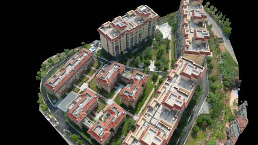
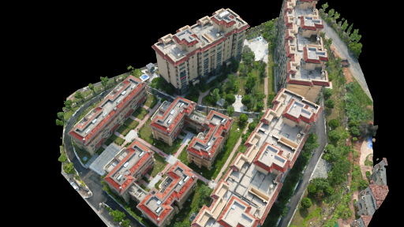
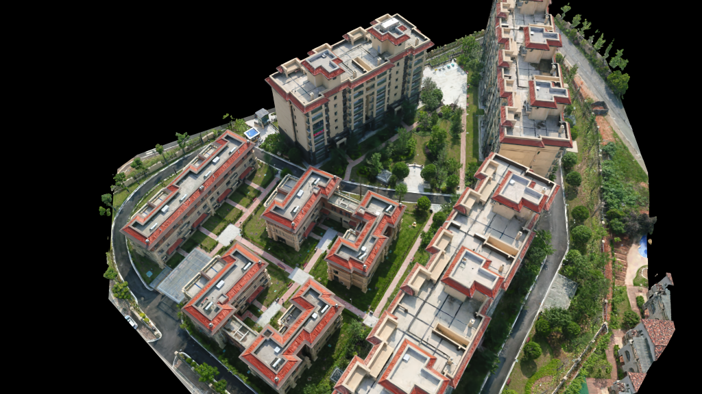
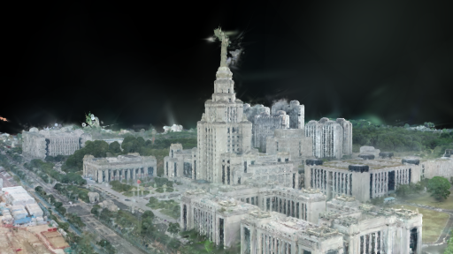

# PiLoT 官方 Demo 复现参考指南


本文是对 Cheng 等人的论文《PiLoT: Neural Pixel-to-3D Registration for UAV-based Ego and Target Geo-localization（CVPR 2026）》及其公开代码的第三方实验复现资料，供学习与复查使用。PiLoT 方法、原始代码、数据集与预训练模型来自原作者；本资料的工作包括环境排错、公开 Demo 验证、运行结果整理，以及少帧目标像素标注和地图投影工具，不属于原创定位方法，也不是作者官方教程。

- [原论文](https://cvpr.thecvf.com/virtual/2026/poster/37000) · [作者项目主页](https://nudt-sawlab.github.io/PiLoT/) · [官方代码](https://github.com/nudt-sawlab/PiLoT)
- [公开 Demo 数据](https://huggingface.co/datasets/choyaa/PiLoT-demo)；代码许可与原作者版权声明见 [LICENSE](LICENSE)。数据、模型和第三方依赖遵循各自的使用条款。
- 配套脚本、配置和本文应一起获取；只复制 Markdown 不能获得本文新增的标注、目标投影及兼容工具。

本文按“环境配置 → 数据下载与检查 → Feicuiwan → SMBU”的顺序组织。命令可作为复现步骤，表格中的数值则是下述验证环境的运行记录，受随机采样、输入配置及软件版本影响，不要求新机器逐位一致。

| 已完成内容 | 数据范围 | 评估与边界 |
|---|---|---|
| Feicuiwan 自定位 | 300 帧，512×288 基准及 1024×576 展示测试 | 平移误差为米，角度为度 |
| SMBU 自定位 | 694 帧，512×288 | 平移为归一化模型单位，不能直接视作米 |
| Feicuiwan 目标地理定位功能展示 | 5 帧人工点选地标 | 输出预测经纬度和模型高程；由于缺少独立目标真值，无法评估精度 |

**与论文主实验的区别：**以上完成的是公开版 Demo 推理和功能验证。官方仓库说明，论文实验采用 3D Tiles 与专有渲染器，发布版提供 3DGS 后端。本文未完整复现论文表 2/表 3 的基准测试、基线方法比较或消融实验；可视化开关和分辨率测试属于本次复现的补充检查。两项自定位 Demo 均加载预训练模型，不从头训练 PiLoT。

本文随附两场景的精选可视化结果：Feicuiwan 的 512×288 基准版和 1024×576 展示版、SMBU 的 512×288 版，每组包含第 0–2 帧地图渲染图及完整可视化视频。它们位于 `docs/media/`，不是完整数据集或全部运行缓存；图像和场景模型来源见上方官方链接。

展示图像保留原始 PNG，视频采用便于浏览器播放的 H.264 格式，保留原分辨率、10 FPS 和帧数。视频编码转换只改变展示副本，不重新运行定位，也不改变下文的实验指标。

## 使用前准备与源码来源

需要 Linux、可工作的 NVIDIA 驱动、Conda，以及与 PyTorch 配套的 CUDA Toolkit 和 C++ 编译器。本文验证的是 RTX 3050 6 GB + CUDA 12.4 + CPython 3.8.20；其他显卡需要调整 CUDA 编译架构，示例中的 `8.6` 专用于本机显卡。

本文使用的 PiLoT 源码基线为 `a27028fd22be1de5d6f13c8a1b35ea63dbbfb86a`，CityGaussian 为 `3c1e93b38712334877ff3cfdf724e4ec7ee3e65b`。建议先在独立目录克隆官方源码，以保留扩展恢复步骤所需的上游 Git 历史：

```bash
mkdir -p ~/course
cd ~/course
git clone https://github.com/nudt-sawlab/PiLoT.git PiLoT
cd PiLoT
git checkout --detach a27028fd22be1de5d6f13c8a1b35ea63dbbfb86a
```

本目录提供复现指南、辅助脚本、配置及精选结果，不包含完整 PiLoT 源码。请先完成上面的官方源码克隆，再在新克隆的源码根目录复制本目录的辅助文件（先将下方路径替换为本目录的实际位置）：

```bash
PILOT_REPRO_DIR=/absolute/path/to/paper-reproductions/experiments/PiLoT
cp -a "$PILOT_REPRO_DIR/scripts/." ./scripts/
cp -a "$PILOT_REPRO_DIR/configs/." ./configs/
cp -a "$PILOT_REPRO_DIR/docs/." ./docs/
cp "$PILOT_REPRO_DIR/PiLoT_record.md" ./PiLoT_record.md
```

下文的命令均在官方源码工作目录执行，`~/course/PiLoT` 仅为示例路径；源码放在其他位置时替换为自己的路径。已经完成复现的读者可保留现有工作目录，按需阅读后续章节。

## 一、环境配置

### 1.1 初始化 Conda 并创建基础环境

以下以 Anaconda 安装于 `~/anaconda3` 为例；使用 Miniconda 或其他安装目录时替换路径。首次在 Bash 中使用 Conda 时，初始化 shell：

```bash
~/anaconda3/bin/conda init bash
source ~/.bashrc
conda --version
conda env list
```

如果`conda`命令仍不可用，可在当前终端直接加载 Conda：

```bash
source ~/anaconda3/etc/profile.d/conda.sh
conda --version
```

新机器从零建立 PiLoT 基础环境时，先创建名为`pilot`的 CPython 3.8 环境，再安装与 CUDA 12.4 对应的 PyTorch：

```bash
conda create -n pilot python=3.8.20 pip -y
conda activate pilot
conda install pytorch=2.4.1 torchvision=0.19.1 torchaudio=2.4.1 pytorch-cuda=12.4 -c pytorch -c nvidia
```
### 1.2 复现环境

- 操作系统：Ubuntu 20.04 LTS
- GPU：NVIDIA GeForce RTX 3050（6 GB）
- CUDA Toolkit：`/usr/local/cuda-12.4`
- Conda 环境：`pilot`
- Python：CPython 3.8.20
- PyTorch：2.4.1，`torch.version.cuda == 12.4`
- `pytorch-lightning`：2.4.0

确认使用 CPython，便于匹配 PyTorch 与 CUDA 扩展的二进制接口：
```bash
conda activate pilot
python -c "import platform, sys; print(platform.python_implementation(), sys.version)"
```

应看到`CPython 3.8.x`，如果显示GraalPy，需要重新安装该环境中的CPython Python后再继续：
```bash
conda install -n pilot python=3.8.20
```

建议在创建新环境时直接指定 `python=3.8.20`，安装后确认解释器输出为 `CPython`。

### 1.3 安装 Python 依赖

在 PiLoT 根目录执行：

```bash
cd ~/course/PiLoT
conda activate pilot
python -m pip install -r requirements.txt
python -m pip check
```

`pip check`应输出`No broken requirements found.`。

若配置的PyPI镜像发生TLS EOF或SHA256校验错误，可临时使用官方PyPI并禁用本机缓存重试，保留哈希校验：

```bash
python -m pip --isolated install --no-cache-dir \
  --index-url https://pypi.org/simple --timeout 120 --retries 10 \
  -r requirements.txt
```

验证 PyTorch 和 GPU：

```bash
python -c "import torch; print(torch.__version__, torch.version.cuda, torch.cuda.is_available()); print(torch.cuda.get_device_name(0) if torch.cuda.is_available() else 'GPU unavailable')"
nvidia-smi
```

在本文环境中，预期包含 `2.4.1`、`12.4`、`True` 和 `NVIDIA GeForce RTX 3050`；使用其他受支持显卡时，设备名称应与自己的硬件一致。

### 1.4 编译 PiLoT 的 CUDA 扩展

上述 PiLoT 基线没有把 `DirectAbsoluteCost_cuda.cu` 放在工作树中，但构建脚本仍然需要它。以下步骤应在保留官方 Git 历史的源码工作目录执行，从上游历史版本恢复源文件并在本机编译：

```bash
cd ~/course/PiLoT
git fetch origin 651375ca519d2d69a8f9e70a44c8fd01b3836c5a
git restore --source=651375ca519d2d69a8f9e70a44c8fd01b3836c5a -- \
  DirectAbsoluteCostCuda/DirectAbsoluteCost_cuda.cu

cd DirectAbsoluteCostCuda
CUDA_HOME=/usr/local/cuda-12.4 \
TORCH_CUDA_ARCH_LIST=8.6 \
python setup_build.py install
cd ..
```

复现时使用的RTX 3050的计算能力是8.6。编译时出现`setup.py install is deprecated` 或缺少`ninja` 的 warning 不影响结果。

验证时必须先导入 `torch`，并且从 PiLoT 根目录执行，避免被`DirectAbsoluteCostCuda/`中的旧`.so`遮蔽：

```bash
python -c "import torch, direct_abs_cost_cuda; print(torch.__version__, torch.version.cuda); print(hasattr(direct_abs_cost_cuda, 'residual_jacobian_batch_quat_cuda'), hasattr(direct_abs_cost_cuda, 'optimizer_step_cuda'))"
```

应输出 `2.4.1 12.4 True True`。

### 1.5 Feicuiwan的3DGS CUDA依赖安装

```bash
cd ~/course/PiLoT
conda activate pilot
export CUDA_HOME=/usr/local/cuda-12.4
export MAX_JOBS=2
TORCH_CUDA_ARCH_LIST=8.6 python -m pip install --no-build-isolation \
  git+https://github.com/graphdeco-inria/diff-gaussian-rasterization.git@59f5f77e3ddbac3ed9db93ec2cfe99ed6c5d121d

TORCH_CUDA_ARCH_LIST=8.6 python -m pip install --no-build-isolation \
  git+https://github.com/graphdeco-inria/gaussian-splatting.git@54c035f7834b564019656c3e3fcc3646292f727d#subdirectory=submodules/simple-knn
```

验证是否安装成功：

```bash
python -c "import torch, diff_gaussian_rasterization, simple_knn; from pixloc.utils.gs3d.gaussian_model import GaussianModel; from pixloc.utils.gs3d.gaussian_renderer import render; print('3DGS imports: OK')"
```

Feicuiwan使用vanilla 3DGS PLY，不依赖CityGaussian；SMBU案例才需要CityGaussian的`internal`包和对应场景模型。

## 二、数据下载及完整性检查

### 2.1 下载公开Demo数据

旧版项目文档指向`choyaa/PiLoT-data`，它是受限训练集，不包含`data_demo/`。公开 Demo 已迁移到`choyaa/PiLoT-demo`；当前仓库的`scripts/download_data_demo.sh`已修正为该仓库，并且会先列出完整文件树再逐个下载，避免旧版`huggingface_hub`只看到 README 的问题。

安装Hugging Face Hub的Python客户端，提供 hf 命令：

```bash
conda activate pilot
python -m pip install -U huggingface_hub hf-xet
```

下载 Feicuiwan 所需数据：

```bash
cd ~/course/PiLoT
./scripts/download_data_demo.sh feicuiwan
```

如果 Xet 传输长时间为 `0 B/s`，改走常规 HTTP：

```bash
HF_HUB_DISABLE_XET=1 ./scripts/download_data_demo.sh feicuiwan
```

下载可中断，重复执行同一命令会复用缓存并继续下载。公开仓库通常不要求登录；如果遇到`401/403`，先执行`hf auth login`并使用具有Read权限的Token（使用hugging face账户）。

下载后应包含：

```text
data_demo/3dgs_model/point_cloud.ply
data_demo/pretrained_model/model@mapscape@512@Fourier.ckpt
data_demo/query/images/3dgs_test/0_0.png ... 299_0.png
data_demo/query/poses/3dgs_test.txt
```

### 2.2 Feicuiwan数据完整性检查

```bash
find data_demo -type f | wc -l
find data_demo/query/images/3dgs_test -type f -name '*.png' | wc -l
du -sh data_demo
unzip -t data_demo/pretrained_model/model@mapscape@512@Fourier.ckpt | tail -1
```

本次已验证的结果：

- 总文件数：304
- 查询图像：300 张，编号 `0`–`299`
- 图像格式：3840×2160 RGB
- `point_cloud.ply`：1,394,853,490 bytes
- 预训练权重：29,830,390 bytes
- `unzip -t`：`No errors detected in compressed data`
- 数据目录大小：约 4.3 GB

检查全部PNG是否可解码：

```bash
python - <<'PY'
from pathlib import Path
from PIL import Image

files = sorted(Path('data_demo/query/images/3dgs_test').glob('*.png'))
assert len(files) == 300, f'expected 300 PNG files, found {len(files)}'
for path in files:
    with Image.open(path) as image:
        image.verify()
print(f'valid PNG files: {len(files)}')
PY
```

Feicuiwan下载完成时本机记录的304个文件是该Demo数据快照：300张查询图像、PLY 场景、PiLoT checkpoint及说明/位姿文件。之后再下载SMBU数据会增加`data_demo/`的总文件数和占用空间，所以复查时应分别统计子目录。

### 2.3 下载并检查SMBU数据

SMBU所需数据也在公开的`choyaa/PiLoT-demo`数据集中。此时可直接使用已安装 Hugging Face 客户端的 `pilot` 环境下载，无需提前创建第四部分的 `pilot-smbu`：

```bash
conda activate pilot
cd ~/course/PiLoT
HF_HUB_DISABLE_XET=1 ./scripts/download_data_demo.sh smbu
```

下载后检查 checkpoint、COLMAP 稀疏模型、查询图片和真值位姿：

```bash
test -s data_demo/smbu_model/checkpoints/epoch=60-step=30000.ckpt && echo checkpoint_OK
test -d data_demo/smbu_model/sparse/sparse/0 && echo sparse_OK
test -d data_demo/query/images/smbu_seq2 && echo images_OK
test -s data_demo/query/poses/smbu_seq2.txt && echo poses_OK
find data_demo/query/images/smbu_seq2 -maxdepth 1 -type f -name '*.png' | wc -l
wc -l data_demo/query/poses/smbu_seq2.txt
du -sh data_demo/smbu_model data_demo/query/images/smbu_seq2
```

本机检查记录：SMBU 查询图像为 694 张，分辨率 960×540；位姿文件也有 694 条记录。`data_demo/smbu_model/`约 7.9 GB，SMBU查询图像目录约526MB。下载若因Xet长时间停滞，可以保持`HF_HUB_DISABLE_XET=1`后重试；脚本会复用已下载文件。

## 三、Feicuiwan Demo实验

### 3.1 实验内容及首次运行

需要注意`run_feicuiwan.sh`不是训练脚本，而是推理/定位评估脚本。它会加载已有的3DGS场景和PiLoT预训练权重，渲染参考视图，逐帧估计并细化无人机查询图像的相机位姿，最后与`3dgs_test.txt`中的真值位姿比较。不会重新训练网络或更新 checkpoint。

**先检查基准分辨率：**配套的 `configs/demos/feicuiwan.yaml` 保留了本次展示实验的 `cam_query.max_size: 1024`。首次按本文复现时，先将它改为 `512`，使第 3.1–3.3 节运行在 512×288；到第 3.4 节再改为 `1024`。视频帧率保持 10 FPS。不同实验请使用不同输出名，避免覆盖需保留的结果。

首次运行还会由`segmentation_models_pytorch`下载MobileOne-S0的ImageNet编码器权重。若出现`PytorchStreamReader failed reading zip archive`，说明该缓存下载不完整；保留损坏文件后重新下载：

```bash
conda activate pilot
mkdir -p ~/.cache/torch/hub/checkpoints
mv ~/.cache/torch/hub/checkpoints/mobileone_s0_unfused.pth.tar \
   ~/.cache/torch/hub/checkpoints/mobileone_s0_unfused.pth.tar.incomplete 2>/dev/null || true
python - <<'PY'
from segmentation_models_pytorch.encoders import get_encoder
encoder = get_encoder('mobileone_s0', in_channels=3, depth=3, weights='imagenet')
print('MobileOne-S0 weights: OK', encoder.out_channels)
PY
```

```bash
conda activate pilot
cd ~/course/PiLoT
./scripts/run_feicuiwan.sh
```

输出默认写入`outputs/3dgs_test.txt`。可视化时需要添加参数：

```bash
./scripts/run_feicuiwan.sh 3dgs_test --viz
```

### 3.2 512×288基准运行与结果

本节记录的是`cam_query.max_size: 512`时的基准运行。当前工作区的`configs/demos/feicuiwan.yaml`已为展示实验调整为 `1024`；重跑基准时，先把该值改回 `512`。原始查询图为 3840×2160，512 尺度对应渲染和定位分辨率 512×288。

运行命令：

```bash
./scripts/run_feicuiwan.sh 3dgs_test
```

本次运行中渲染进程和定位进程均正常结束，完成 300 张查询图像的定位与评估。结果如下：

| 指标 | Median | Std Dev |
|---|---:|---:|
| Translation Error | 1.137 m | 1.414 m |
| Rotation Error | 1.191° | 0.664° |
| Yaw Error | 1.014° | 0.222° |

召回率：

- Translation < 1 m：40.33%
- Translation < 3 m：92.00%
- Translation < 5 m：96.00%
- Rotation < 1°：15.33%
- Rotation < 3°：96.00%
- Rotation < 5°：100.00%

估计位姿文件为`outputs/3dgs_test.txt`，共包含 300 条记录，表明 Feicuiwan 推理和评估流程已在当前设备上成功运行。

### 3.3 可视化运行结果与误差分析

运行命令：

```bash
./scripts/run_feicuiwan.sh 3dgs_test --viz
```

可视化运行同样完成了 300 张查询图像的定位与评估。本次结果为：

| 指标 | Median | Std Dev |
|---|---:|---:|
| Translation Error | 1.198 m | 1.792 m |
| Rotation Error | 1.148° | 0.833° |
| Yaw Error | 1.005° | 0.243° |

召回率：

- Translation < 1 m：41.67%
- Translation < 3 m：82.33%
- Translation < 5 m：91.67%
- Rotation < 1°：20.00%
- Rotation < 3°：91.33%
- Rotation < 5°：100.00%

生成的文件包括：

- `outputs/3dgs_test.txt`：300条估计位姿。
- `outputs/3dgs_test/<frame>.png`：从估计位姿在3DGS地图中渲染出的512×288 RGB参考图。
- `outputs/3dgs_test/<frame>.npy`：与渲染图对应的512×288深度图，供反投影和位姿优化使用。
- `outputs/3dgs_test/visualization.mp4`：512×288、10 FPS 的查询图与渲染图对齐视频。本次文件约 6.0 MB。

视频并不是透明度各50%的整图叠加。每一帧的外围区域是真实查询图，中央矩形由 3DGS 渲染图直接替换。通过观察中央矩形边界两侧的楼顶、道路和建筑轮廓是否连续，可以快速判断估计位姿是否对齐：

- 边界处结构越连续，说明渲染视角与真实相机视角越接近。
- 本次数值评估仍有约 1 m、1°量级的定位误差；图中边缘错位可作定性参考，不能直接据此计算误差。
- 渲染图比真实图更清晰或颜色不同，主要来自真实航拍的雾气、曝光以及 3DGS 建图时间差，不应仅凭颜色差异判断定位失败。
- 渲染区域中的纯黑块表示 PLY 地图在该方向缺少高斯点或覆盖不完整，不是查询图损坏。抽查第 0、75、150、225 和 298 帧时，主要建筑及环形道路总体能够在中央边界处衔接，和数值评估结果一致。

日志中的：

```text
Viz skip missing render for 299_0.png
Visualization video saved (299 frames)
```

是当前流水线的可视化边界行为。最后一张查询图会完成定位并写入第 300 条位姿，但代码不会再把最后估计位姿送回渲染进程，因此没有 `299_0.png`，视频包含第 0–298 帧，共 299 帧，不影响 300 帧定位评估。两次运行的指标略有差异，是随机抽取优化用 3D 点带来的正常波动。

#### 精选输出：前三帧与基准视频

下面是第 0–2 帧估计位姿对应的 3DGS 地图渲染参考图，不是原始查询照片，也不包含单独的初始化图 `0_init.png`。点击图片可查看原尺寸。

| 第 0 帧 | 第 1 帧 | 第 2 帧 |
|---|---|---|
| [](docs/media/feicuiwan_512/0_0.png) | [](docs/media/feicuiwan_512/1_0.png) | [](docs/media/feicuiwan_512/2_0.png) |

[查看或下载 Feicuiwan 基准可视化视频](docs/media/feicuiwan_512/visualization.mp4)（512×288，10 FPS，299 帧，约 29.9 秒）。视频用于观察查询图与地图渲染的结构对齐，不代替前面的误差评估。

### 3.4 RTX 3050高分辨率展示实验

完成 512×288 基准复现后，为了提升一定的清晰度，尝试将`configs/demos/feicuiwan.yaml`中的`cam_query.max_size`从`512` 调整为`1024`。由于原始查询图是 3840×2160（16:9），后续定位、3DGS 渲染、PNG 和可视化视频的原生分辨率均为 1024×576。视频写出帧率保持 10 FPS。

为保留前面的512基准输出，使用新的实验输出名运行得到新的结果：

```bash
conda activate pilot
cd ~/course/PiLoT
./scripts/run_feicuiwan.sh 3dgs_test_1024 --viz
```

该名称只改变输出目录和结果文件名，配置中的查询序列仍是`3dgs_test`。新结果写入：

```text
outputs/3dgs_test_1024.txt
outputs/3dgs_test_1024/*.png
outputs/3dgs_test_1024/*.npy
outputs/3dgs_test_1024/visualization.mp4
```

运行日志中的`GS3DRenderer ready`应显示`1024x576`，生成的视频应为1024×576、10FPS。提高分辨率会改变特征提取和随机采样过程，因此新指标应作为高分辨率实验单独记录，不与第3.2、3.3节的512×288指标混写。如果出现CUDA out of memory，可将`max_size`降为 `768`（对应 768×432）。

本机1024×576可视化运行已成功完成，核验得到300条位姿、300张渲染 PNG、300个深度 NPY，以及299帧的1024×576、10 FPS视频。结果如下：

| 指标 | Median | Std Dev |
|---|---:|---:|
| Translation Error | 1.881 m | 7.122 m |
| Rotation Error | 1.398° | 2.777° |
| Yaw Error | 1.197° | 1.061° |

召回率：

- Translation < 1 m：21.00%
- Translation < 3 m：70.33%
- Translation < 5 m：81.00%
- Rotation < 1°：13.00%
- Rotation < 3°：82.33%
- Rotation < 5°：85.67%

本次高分辨率结果比 512×288 基准误差更大。可能的影响因素包括输入尺度变化与预训练特征/优化器适配，以及像素数增加到 4 倍后每帧仍只采样 500 个 3D 点；随机采样也会造成运行间差异。7.122 m 的平移标准差说明本次存在较大的离群误差，但单次测试不能确定各因素的因果贡献。因此以第 3.2、3.3 节的 512×288 结果为基准，1024×576 仅记录为高分辨率展示测试。

#### 精选输出：1024×576 展示版

以下图片和视频来自独立的 `3dgs_test_1024` 运行，对应本节的高分辨率实验结果，不能套用 512×288 的基准精度。

| 第 0 帧 | 第 1 帧 | 第 2 帧 |
|---|---|---|
| [](docs/media/feicuiwan_1024/0_0.png) | [](docs/media/feicuiwan_1024/1_0.png) | [](docs/media/feicuiwan_1024/2_0.png) |

[查看或下载 Feicuiwan 高分辨率可视化视频](docs/media/feicuiwan_1024/visualization.mp4)（1024×576，10 FPS，299 帧，约 29.9 秒）。

### 3.5 点击地标并保存目标像素坐标

本节与第 3.6 节使用本复现补充的交互标注和离线投影工具，展示 PiLoT 中由目标像素、相机位姿和地图深度计算目标地理坐标的流程。它属于少量帧的目标地理定位功能验证，不等同于原论文目标定位主实验的定量复现。

这里选取第 0、75、150、225 和 298 帧，覆盖序列中的不同时间位置。少量帧便于观察点选位置和预测结果，也能减少人工标注和重复图片展示；选帧目的是简洁展示完整流程，不作为全序列定位精度的统计样本。第 299 帧没有对应的可视化渲染和深度缓存，因此本例使用第 298 帧作为末段示例。

选择 Feicuiwan 是因为其地图具有现成的地理参考信息，可以将地图位置转换为经纬度和模型高程。现有 SMBU Demo 使用归一化模型坐标，尚缺少模型坐标到真实地理坐标的完整尺度和配准关系；要输出可解释的经纬高，还需额外标定。因此，SMBU 用于第四部分的无人机自定位验证，本节使用 Feicuiwan 完成目标地理定位展示。

目标像素标注可以通过鼠标点击完成。先在具有图形桌面的终端中运行以下工具，打开 Feicuiwan 的 5 张示例查询图片：

```bash
conda activate pilot
cd ~/course/PiLoT
python scripts/annotate_target_points.py --frames 0 75 150 225 298
```

窗口中用鼠标左键点击想定位的固定地标，例如路口或地面角点。点击后会出现红色十字，并立即保存坐标；再次点击可以更换当前位置。按 `N` 或空格切换到下一张，按 `P` 返回上一张，按 `C` 或鼠标右键清除当前图的点，按 `Q` 或 `Esc` 退出。再次运行会加载已有标注。

默认输出为 `data_demo/query/bbox/3dgs_test/3dgs_test_xy.txt`，每条记录的格式为 `图片名 x y`，每张图一个点。工具会按配置去畸变，并把缩小预览中的点击位置还原为原始分辨率的像素坐标；用户无需计算缩放比例或填写深度。

这一步准备的是像素标注，目标经纬高需在后续结合位姿和渲染深度计算。当前命令只标注所选的 5 帧；全序列目标定位入口要求逐帧标注，所以先保留这些点供少帧验证，尚不能直接开启全序列的 `enable_target_indicator`。没有目标地理坐标真值时，只能展示预测坐标，不能计算论文中的目标定位误差。

读者可自行选择清晰、静止且处于地图覆盖范围内的地面或建筑地标，不必手工填写深度。所选像素不同，最终预测坐标也会不同；下面的坐标表只记录本次实际点选结果，不是重新标注后必须得到的标准答案。

### 3.6 用标注点和已有深度生成目标定位演示

完成点选标注，并确认第 3.3 节的可视化运行已经生成 `outputs/3dgs_test.txt` 及 `outputs/3dgs_test/` 中的 PNG、NPY 缓存后，运行：

```bash
conda activate pilot
cd ~/course/PiLoT
python scripts/localize_annotated_targets.py
```

脚本读取已标注帧、`outputs/3dgs_test.txt` 中的估计位姿和 `outputs/3dgs_test/` 中同名深度/渲染图，在 CPU 上计算目标预测坐标，无需重新运行 300 帧定位或加载 3DGS 模型。深度尺寸以缓存文件为准：本次缓存为 512×288，不受当前配置中 1024 展示分辨率的影响。工具会处理查询相机与渲染相机的内参差异，把点击位置映射到对应深度像素，并检查有效深度和地图覆盖。

位姿文件和渲染缓存应保留自同一次运行。若前面使用了其他输出名，可通过 `--run outputs/<输出名>` 指定同名的位姿文件和缓存目录；不要将不同次运行的位姿与深度混用。日志中的 `SKIP` 表示该点因缺失缓存、无效深度或地图覆盖不足等原因未生成坐标，可根据提示重新点选并运行。

首次结果写入 `outputs/target_demo/`，再次运行时自动创建 `target_demo_2/` 等新目录。目录包括：

- `targets.csv`：每个点的像素坐标、渲染深度、预测经纬度、模型高程及处理状态。
- `targets_wgs84.txt`：有效点的 `图片名 经度 纬度 模型高程`。
- 同名 PNG：左侧为去畸变查询图，右侧为地图渲染图；红色十字标出点击点及其对应的深度采样位置。
- `summary.json`：输入来源、相机参数、采用的位姿和处理结果。

本次输出目录为 `outputs/target_demo_2/`。5 个标注点均完成投影，预测值如下：

| 帧 | 经度（°） | 纬度（°） | 模型高程（m） | 相机 Z 深度（m） |
|---|---:|---:|---:|---:|
| 0 | 112.98953037 | 28.29199825 | 51.92 | 128.97 |
| 75 | 112.98953394 | 28.29199530 | 51.85 | 129.53 |
| 150 | 112.98953454 | 28.29199308 | 52.06 | 128.62 |
| 225 | 112.98953056 | 28.29200037 | 52.18 | 130.29 |
| 298 | 112.98953695 | 28.29244471 | 52.67 | 109.69 |

这里的 `5/5` 表示 5 个点都具备可用深度并生成了坐标，不代表 100% 定位准确率或论文中的召回率。深度来自现有 3DGS 的 alpha 加权相机 Z 深度，表示相机光轴方向的深度估计，不是目标到相机的直线距离；地图低覆盖区域可能存在偏差。高程沿用模型的垂直基准，不能直接解释为离地高度。经纬度保留的小数位只用于记录输出，不代表相同水平的实际精度。当前没有独立的目标实测真值，所以本节属于功能演示，尚不能用于复现论文中的米制目标误差和召回率。

观察同名 PNG 时，左侧为去畸变查询图，右侧为 3DGS 地图渲染图。左侧红十字是人工选择的目标像素，右侧红十字是映射后的深度采样位置；可以检查两侧是否落在同一建筑或地面结构上。它们不是两次独立检测或实测定位，不能仅凭标记相近就判定地理坐标精确。若不同帧点选的是不同地标，也不能将它们的坐标差当作同一目标的重复定位误差。


## 四、SMBU 实验

PiLoT主分支提供的另一个官方Demo是 SMBU seq2。它使用 CityGaussian checkpoint、归一化模型坐标和时序特征约束。下面是验证成功的下载、环境、测试和正式运行的流程记录。

### 4.1 SMBU数据准备

下载命令见第二部分 2.3 节。进入 PiLoT 仓库根目录后运行下面的检查。单独运行`test -s`或`test -d`成功时默认不会打印内容，只会返回成功状态；下面的检查会明确打印`OK`，失败时打印`FAIL`并停止。完整通过应看到 checkpoint、COLMAP模型和位姿文件均为`OK`，查询图片数与位姿行数均为 694。

```bash
check_file() {
  if test -s "$1"; then
    echo "OK: $1"
  else
    echo "FAIL: missing or empty: $1"
    return 1
  fi
}

check_file data_demo/smbu_model/checkpoints/epoch=60-step=30000.ckpt || exit 1
check_file data_demo/smbu_model/sparse/sparse/0/cameras.bin || exit 1
check_file data_demo/smbu_model/sparse/sparse/0/images.bin || exit 1
check_file data_demo/smbu_model/sparse/sparse/0/points3D.ply || exit 1
check_file data_demo/query/poses/smbu_seq2.txt || exit 1

image_count=$(find data_demo/query/images/smbu_seq2 -maxdepth 1 -type f -name '*.png' | wc -l)
echo "SMBU query images: $image_count (expected 694)"
test "$image_count" -eq 694 || { echo "FAIL: query image count"; exit 1; }

pose_count=$(awk 'END {print NR}' data_demo/query/poses/smbu_seq2.txt)
echo "SMBU pose records: $pose_count (expected 694)"
test "$pose_count" -eq 694 || { echo "FAIL: pose record count"; exit 1; }
echo "SMBU data check passed."
```

正常时会看到类似以下结果（文件路径按上面的检查项逐行列出）：

```text
OK: data_demo/smbu_model/checkpoints/epoch=60-step=30000.ckpt
OK: data_demo/smbu_model/sparse/sparse/0/cameras.bin
OK: data_demo/smbu_model/sparse/sparse/0/images.bin
OK: data_demo/smbu_model/sparse/sparse/0/points3D.ply
OK: data_demo/query/poses/smbu_seq2.txt
SMBU query images: 694 (expected 694)
SMBU pose records: 694 (expected 694)
SMBU data check passed.
```

若任何文件缺失/为空，或图像数、位姿行数不等于694，检查会报`FAIL`；此时不要继续运行实验，先按第二部分2.3节重新下载并复查。此项检查用于确认关键文件是否存在且序列数量是否匹配。
### 4.2 建立隔离的 SMBU 环境

本次使用的 CityGaussian 提交要求 `pytorch-lightning==2.3.*`，而已验证的 Feicuiwan 环境使用 2.4.0。为保留已经成功的环境，建议克隆并重新配置一个新环境而不是直接修改 `pilot`：

```bash
conda create -n pilot-smbu --clone pilot
conda activate pilot-smbu
```

### 4.3 安装验证版本的 CityGaussian

PiLoT 文档中的旧 `environment.yml` 命令不适用于本次使用的 CityGaussian 版本。使用包含 `internal/` 包的仓库，并固定到验证过的提交：

```bash
cd ~/course/PiLoT
if [[ ! -d third_party/CityGaussian/.git ]]; then
  GIT_HTTP_LOW_SPEED_LIMIT=0 GIT_HTTP_LOW_SPEED_TIME=600 \
    git -c http.version=HTTP/1.1 -c core.compression=0 \
    clone --depth 1 --filter=blob:none --single-branch \
    https://github.com/Linketic/CityGaussian.git third_party/CityGaussian
fi
cd third_party/CityGaussian
git fetch --depth 1 origin 3c1e93b38712334877ff3cfdf724e4ec7ee3e65b
git checkout --detach 3c1e93b38712334877ff3cfdf724e4ec7ee3e65b
git submodule update --init --recursive
cd ../..
python scripts/prepare_citygaussian_py38.py

export CUDA_HOME=/usr/local/cuda-12.4
export TORCH_CUDA_ARCH_LIST=8.6
python -m pip --isolated install --no-cache-dir \
  --index-url https://pypi.org/simple --timeout 120 --retries 10 \
  -r third_party/CityGaussian/requirements.txt
python -m pip install -e third_party/CityGaussian
python -m pip check
```

如果主仓库克隆中断，先检查`third_party/CityGaussian`是否已存在；若存在且含`.git`，可在目录内重试`git fetch --depth 1 origin main`后再继续。若出现TLS EOF，通常是 GitHub 连接中断；使用可用代理或重新执行浅克隆命令。若镜像TLS失败或SHA256校验不匹配，使用上面的`--isolated --no-cache-dir`官方源命令重试，不要关闭哈希校验。

记录实际安装的CityGaussian提交，便于复现：

```bash
git -C third_party/CityGaussian rev-parse HEAD
```

本次验证使用的提交为 `3c1e93b38712334877ff3cfdf724e4ec7ee3e65b`。

验证PiLoT所需接口：

```bash
python -c "from internal.cameras.cameras import Cameras; from internal.utils.gaussian_model_loader import GaussianModelLoader; print('CityGaussian imports: OK')"
python -c "import torch, direct_abs_cost_cuda; print(torch.__version__, torch.version.cuda, torch.cuda.is_available())"
```

### 4.4 SMBU专用CUDA扩展与Python 3.8兼容

实际复现使用独立环境`pilot-smbu`，其关键版本为：

- Python：`3.8.20`（CPython）
- PyTorch：`2.4.1`，CUDA runtime `12.4`
- Lightning：`2.3.3`
- `pytorch-lightning`：`2.3.3`
- `bitsandbytes`：`0.45.5`
- CityGaussian：`3c1e93b38712334877ff3cfdf724e4ec7ee3e65b`

SMBU checkpoint使用`SepDepthTrim2DGSRenderer`，依赖CityGaussian专用的trim-surfel CUDA扩展。`requirements.txt`不会自动安装它，需在CityGaussian和Python包依赖安装后补装：

```bash
conda activate pilot-smbu
cd ~/course/PiLoT
export CUDA_HOME=/usr/local/cuda-12.4
export TORCH_CUDA_ARCH_LIST=8.6
export MAX_JOBS=2

python -m pip install --no-build-isolation \
  "git+https://github.com/DekuLiuTesla/diff-surfel-rasterization.git@9eefc03858a30bb3e5f98eccc56f077420ee2aaf"
```

验证扩展模块和类可以导入：

```bash
python -c "from diff_trim_surfel_rasterization import GaussianRasterizationSettings, GaussianRasterizer; print('trim-surfel: OK')"
```

该版本 CityGaussian 源码包含 Python 3.9 风格的 `list[...]`、`dict[...]` 等类型标注，而本次 SMBU 环境使用 Python 3.8.20。第 4.3 节的配套脚本会在相关的 21 个模块顶部加入 `from __future__ import annotations`，延迟类型标注求值，不改变模型或渲染算法。脚本可重复执行；下面的检查命令不会修改文件：

```bash
python scripts/prepare_citygaussian_py38.py --check
```

应输出 `Checked 21 files; pending: 0`。若仍出现 `TypeError: 'type' object is not subscriptable`，先确认 CityGaussian 提交和脚本使用的目录；不要直接升级已有环境中的 Python，否则 CUDA 扩展也可能需要重新编译。采用其他 CityGaussian 版本时，应另行核查兼容性，不能假定这 21 处修改已经覆盖新版本。

### 4.5 冒烟测试流程与结果

依赖、CUDA 扩展和数据检查通过后，先验证 CityGaussian 渲染、深度和坐标转换，再验证多帧连续定位：

```bash
conda activate pilot-smbu
cd ~/course/PiLoT
python scripts/verify_pilot_2frames.py
python scripts/verify_pilot_nframes.py --num-frames 15 --seed 42
```

两帧测试和 15 帧测试均通过。本次 15 帧测试结果为：

- 有效深度像素：每帧约 `142468`–`143404`
- 平移误差（相对 GT）：均值 `0.010`，最大 `0.030`（normalized 坐标单位）
- 欧拉角误差：均值 `0.19°`，最大 `0.31°`
- 平均处理时间：`227 ms/frame`
- 结论：`PASSED — coordinate chain stable`

### 4.6 SMBU正式流程与结果

先运行不带可视化的正式基线：

```bash
./scripts/run_smbu_seq2.sh
```

该序列包含 694 帧。无可视化运行会将估计位姿写入：

```text
outputs/smbu_seq2.txt
```

而`outputs/smbu_seq2/`目录为空是正常的，因为默认不会保存渲染 PNG 和深度 NPY。

首次正式运行（2026-09-21）日志为：

```text
Normalized pose eval | trans med=0.018 std=0.006 | rot med=0.28 std=0.08 | yaw med=0.06
```

这里的单位必须特别说明：

- `trans`：SMBU 的 CityGaussian 归一化模型单位，不是米。CityGaussian 会平移、旋转场景，并按训练相机到场景焦点的中位距离缩放，使这类距离在归一化坐标中约为 `1`。当前 Demo 没有提供原始重建尺度与米之间的对应关系，因此不能把 SMBU 的平移误差直接换算成米。
- `rot`：度（deg）。
- `yaw`：度（deg）。

配置中的 `mul: 0.001` 只是把坐标缩小后送入学习式优化器，改善数值尺度；它不是“归一化单位到米”的换算系数。要获得米制误差，需要提供与该模型对应的 GPS/ECEF 真值或有米制尺度的 COLMAP 重建及其归一化变换。

从`outputs/smbu_seq2.txt`与`data_demo/query/poses/smbu_seq2.txt`得到：

- 预测帧数：`694/694`
- 平移误差：中位数 `0.0180`，均值 `0.0183`，标准差 `0.0063`，最大 `0.0394`（normalized 坐标单位）
- 旋转误差：中位数 `0.279°`，标准差 `0.079°`，最大 `0.580°`
- Yaw 误差：中位数 `0.064°`，标准差 `0.056°`，最大 `0.355°`
- 平移误差 `<0.03`：`96.69%`
- 平移误差 `<0.05`：`100%`
- 旋转误差 `<1°`：`100%`
- Yaw 误差 `<1°`：`100%`

SMBU的normalized评估函数默认只打印一行中位数和标准差，不像Feicuiwan的ECEF评估那样打印完整召回率表。可以随时重新打印摘要：

```bash
python -c "from pixloc.utils.eval import evaluate_pose_normalized; print(evaluate_pose_normalized('outputs/smbu_seq2.txt', 'data_demo/query/poses/smbu_seq2.txt'))"
```

### 4.7 SMBU可视化结果

正式基线成功后运行：

```bash
./scripts/run_smbu_seq2.sh --viz
```

本次生成结果：

- `outputs/smbu_seq2/`：694 张 `512×288` PNG 和 694 个对应深度 NPY；其中包含初始化视角的 `0_init` 文件
- `outputs/smbu_seq2/visualization.mp4`：`512×288`、10 FPS、693 帧
- 估计位姿文件仍为 `outputs/smbu_seq2.txt`

日志中的：

```text
Viz skip missing render for 693_0.png
Visualization video saved (693 frames)
```

是当前流水线的正常边界行为：最后一帧会完成定位并写入位姿文件，但最后一个估计位姿不会再送回渲染进程，因此缺少 `693_0.png`，视频少 1 帧；不影响 694 帧的位姿评估。

#### 精选输出：前三帧与可视化视频

展示结果取自第 4.9 节单独保留的 `outputs/smbu_seq2_viz/`，对应其“有可视化”一列的运行结果。下图是第 0–2 帧估计位姿对应的地图渲染参考图；黑色天空是模型未覆盖区域的渲染背景，原因见第 4.8 节。

| 第 0 帧 | 第 1 帧 | 第 2 帧 |
|---|---|---|
| [](docs/media/smbu_seq2/0_0.png) | [](docs/media/smbu_seq2/1_0.png) | [](docs/media/smbu_seq2/2_0.png) |

[查看或下载 SMBU 可视化视频](docs/media/smbu_seq2/visualization.mp4)（512×288，10 FPS，693 帧，约 69.3 秒）。视频外围为查询图，中央区域为地图渲染，不能把黑色区域理解为查询图损坏。

### 4.8 SMBU 渲染天空为黑色的原因

SMBU 的查询原图天空是蓝天，但可视化中的中央渲染区域天空为黑色，这是 CityGaussian 渲染结果的背景，并非查询图损坏或定位失败。原因是：

1. CityGaussian checkpoint 保存的是建筑和地面等场景高斯点，天空通常没有对应的 3D 高斯点。
2. 对没有高斯点覆盖的像素，CityGaussian 使用 checkpoint 中的 `background_color`；本 checkpoint 的背景接近黑色。
3. Feicuiwan 使用另一套 vanilla 3DGS PLY 和渲染配置，背景色及场景覆盖范围不同，所以视觉上不会完全相同。

因此黑色天空不代表误差变大，当前 SMBU 的定位指标仍然有效。为了保持定量实验与官方渲染一致，不建议直接把 checkpoint 背景改成蓝色后重新评估。若只是制作展示视频，可以在后处理中用查询图的天空替换未覆盖区域，或保留视频外围的查询图；这属于显示处理，不应混入基线指标。

### 4.9 SMBU有无可视化结果对比及帧数说明

这里分别运行了不带可视化和带可视化的SMBU实验，并使用不同输出名保留结果：

- 无可视化：`outputs/smbu_seq2_no_viz.txt`，日志 `outputs/smbu_seq2_no_viz.log`
- 有可视化：`outputs/smbu_seq2_viz.txt`，日志 `outputs/smbu_seq2_viz.log`

若要重新生成这两组独立结果，使用下面的命令。`run_smbu_seq2.sh` 不接受自定义输出名，因此此处直接使用同一个 `main.py` 入口，仅通过 `--name` 区分输出，不改变数据或算法配置。日志也分别保存，避免被前一次运行覆盖：

```bash
conda activate pilot-smbu
cd ~/course/PiLoT
mkdir -p outputs
set -o pipefail
python main.py -c configs/demos/smbu_seq2.yaml --name smbu_seq2_no_viz \
  2>&1 | tee outputs/smbu_seq2_no_viz.log
python main.py -c configs/demos/smbu_seq2.yaml --name smbu_seq2_viz --viz \
  2>&1 | tee outputs/smbu_seq2_viz.log
```

重复执行仍会覆盖这两个名字的旧结果；希望保留多次运行时，应同时修改 `--name` 和对应日志名。

两份输出均包含`0_0.png`到`693_0.png`共 694 条位姿记录。先前用`wc -l`得到 693，是因为 PiLoT 写结果时最后一条后面没有换行符；`wc -l` 统计换行符而不是记录数。应使用`awk`统计：

```bash
for file in outputs/smbu_seq2_no_viz.txt outputs/smbu_seq2_viz.txt; do
  printf '%s: ' "$file"
  awk 'END {print NR}' "$file"
done
```

预期每个文件均为694条。可视化日志中的`Viz skip missing render for 693_0.png` 表示最后一帧的渲染图没有生成，因此视频为 693 帧；定位仍估计了最后一帧并将其写入位姿文件。少的是最后一张渲染图/一帧视频，不是位姿记录。

根据这两份独立位姿文件与`data_demo/query/poses/smbu_seq2.txt` 重新计算，结果如下。SMBU 平移单位为 CityGaussian 归一化模型单位；角度单位为度。

| 指标 | 无可视化 | 有可视化 |
|---|---:|---:|
| 平移误差 Median | 0.018211 | 0.017889 |
| 平移误差 Mean | 0.018403 | 0.018131 |
| 平移误差 Std Dev | 0.006300 | 0.006225 |
| 平移误差 Max | 0.038978 | 0.038455 |
| 旋转误差 Median | 0.280828° | 0.273446° |
| 旋转误差 Std Dev | 0.079669° | 0.078920° |
| 旋转误差 Max | 0.589660° | 0.519327° |
| Yaw 误差 Median | 0.061002° | 0.060237° |
| Yaw 误差 Std Dev | 0.056888° | 0.055341° |
| Yaw 误差 Max | 0.308582° | 0.284243° |

两次结果非常接近：平移误差`<0.03`的比例分别为`95.82%`和`97.12%`，其余记录的阈值表现也相同（平移`<0.05`、旋转`<1°`、Yaw `<1°`均为`100%`）。这属于随机采样带来的小幅运行波动，不代表`--viz`改变或提升了定位算法。

与 Feicuiwan 的 512×288 基准结果并列如下：

| Demo / 运行方式 | 平移误差 Median ± Std Dev | 旋转误差 Median ± Std Dev | Yaw Error Median ± Std Dev |
|---|---:|---:|---:|
| Feicuiwan，无可视化 | 1.137 ± 1.414 m | 1.191 ± 0.664° | 1.014 ± 0.222° |
| Feicuiwan，可视化 | 1.198 ± 1.792 m | 1.148 ± 0.833° | 1.005 ± 0.243° |
| SMBU，无可视化 | 0.018211 ± 0.006300（归一化单位） | 0.280828 ± 0.079669° | 0.061002 ± 0.056888° |
| SMBU，可视化 | 0.017889 ± 0.006225（归一化单位） | 0.273446 ± 0.078920° | 0.060237 ± 0.055341° |

Feicuiwan 的平移误差以米计，SMBU 的平移误差以归一化模型单位计，缺少归一化尺度到米的标定，因此两者的平移数值不能直接比较。角度指标都以度计，可作结果描述；但场景、数据序列和地图后端不同，不能据此判断某一实验场景下本实验方法普遍更优。

## 附：论文引用与许可

引用原方法时，应引用 PiLoT 论文，而不是将本文的复现过程作为该方法的原创来源。上游提供的引用信息如下：

```bibtex
@inproceedings{cheng2026pilot,
  title={PiLoT: Neural Pixel-to-3D Registration for UAV-based Ego and Target Geo-localization},
  author={Cheng, Xiaoya and Wang, Long and Liu, Yan and Liu, Xinyi and Tan, Hanlin and Liu, Yu and Zhang, Maojun and Yan, Shen},
  booktitle={CVPR},
  year={2026}
}
```

代码版权与许可保留在 [LICENSE](LICENSE)；数据和权重依其各自的来源条款使用。本文的本机数值是运行记录，不是论文官方结果或对原论文精度的保证。
